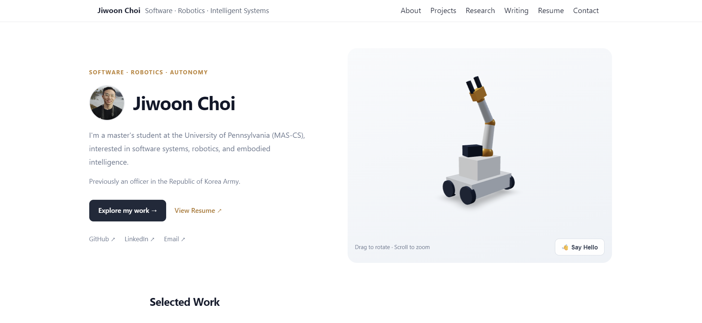

# Jiwoon Choi — Personal Portfolio

**Live Website:** [https://jiwoon-choi.github.io/](https://jiwoon-choi.github.io/)

[](https://jiwoon-choi.github.io/)

My personal portfolio website showcasing my background, technical interests, and projects in software engineering, robotics, and intelligent systems.

The website features an interactive 3D mobile manipulator built with React Three Fiber.

## Tech Stack

- **Astro** — Static site generation
- **React** — Interactive UI components
- **Three.js / React Three Fiber** — 3D rendering and animation
- **React Three Drei** — Camera controls and scene utilities
- **CSS** — Responsive layout and styling
- **Decap CMS** — Browser-based writing management
- **GitHub Pages / GitHub Actions** — Hosting and automated deployment

## Features

### Interactive 3D Robot

- Custom mobile manipulator built using Three.js primitives
- Animated shoulder, elbow, wrist, and sensor
- Interactive greeting animation
- Camera rotation, zoom, and automatic rotation

### Portfolio

- Responsive homepage with profile photo and personal introduction
- Selected software engineering and robotics projects
- Technical interests, education, and research experience
- Downloadable résumé and contact information

### Writing

- Markdown-based essays
- Draft and publication controls
- Optional browser-based editing through Decap CMS

## Getting Started

### Prerequisites

- Node.js 24 (recommended)
- npm

### Installation

```bash
git clone https://github.com/Jiwoon-Choi/jiwoon-choi.github.io.git
cd jiwoon-choi.github.io
npm ci
npm run dev
```

Open http://localhost:4321/ in your browser.

### Production Build

```bash
npm run build
```

The generated static website is written to `dist/`.

## Project Structure

```text
.
├── .github/workflows/deploy.yml
├── public/
│   ├── admin/
│   ├── profile.jpg
│   └── resume_jiwoon_choi.pdf
├── src/
│   ├── components/robot/
│   │   ├── RobotHero.jsx
│   │   └── RobotModel.jsx
│   ├── content/writing/
│   ├── pages/
│   │   ├── index.astro
│   │   └── writing/
│   └── portfolio.css
├── astro.config.mjs
├── package.json
└── README.md
```

## Writing and Content Management

Essays are stored as Markdown files in:

`src/content/writing/`

The public Writing section displays published essays.

### Local Authoring

Create a Markdown file, such as:

`src/content/writing/my-essay.md`

Example:

```md
---
title: "My Essay"
date: 2026-10-17
description: "A short description."
draft: false
---

Write your essay here.
```

Only non-draft essays with publication dates on or before the current date appear on the public website.

### Browser-Based Publishing (Decap CMS)

The website includes a Decap CMS configuration for managing essays through a browser.

**Editor:** https://jiwoon-choi.github.io/admin/

To enable browser publishing:

1. Configure Decap Turbo authentication at https://turbo.decapcms.org/.
2. Connect the GitHub repository:
   `Jiwoon-Choi/jiwoon-choi.github.io`
3. Set the publishing branch to `main`.
4. Use `public/admin/config.yml` as the CMS configuration path.
5. Open `/admin/`, sign in, and create or edit essays.

Publishing an essay commits Markdown changes to GitHub and triggers the deployment workflow.

Browser publishing requires the authentication service to be configured. Local Markdown authoring works independently of the CMS.

## Deployment

The website is hosted on GitHub Pages.

GitHub Actions automatically builds and deploys the site when changes are pushed to `main`.

Workflow: `.github/workflows/deploy.yml`

## Author

**Jiwoon Choi**

Master's student at the University of Pennsylvania, interested in software engineering, robotics, and embodied intelligence.

- **Website:** https://jiwoon-choi.github.io/
- **GitHub:** https://github.com/Jiwoon-Choi
- **LinkedIn:** https://www.linkedin.com/in/jiwoon-choi-117602249/

---

Built with Astro, React, and Three.js.
